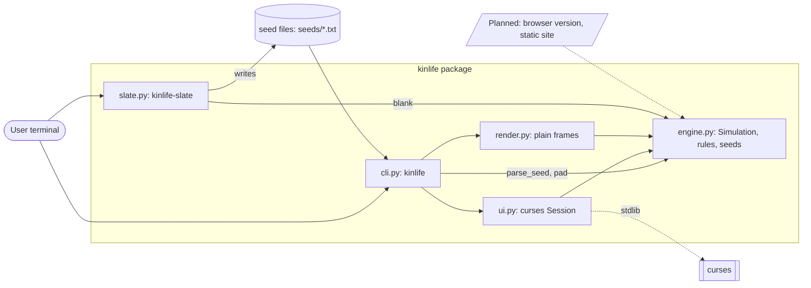

# Kinlife architecture

Kinlife is a single-process Python package (`src/kinlife/`, standard library
only) with two console commands. It has no server, network access, database or
queue, and nothing is deployed yet.

## Overview

| Aspect | Status |
| --- | --- |
| Services | None. Two CLI entry points run in the user's process. |
| Routes | None (no HTTP or IPC surface). |
| Data stores | None. Seed files are read from disk (`seeds/*.txt` or a user file); `kinlife-slate` writes one seed file. |
| Queues | None. |
| External dependencies | None at runtime (`dependencies = []`); `curses` from the standard library for the full-screen UI. Dev only: pytest, pytest-cov, ruff, mypy. |
| Deploy targets | None. Distributed as a source repo (github.com/anphase/kinlife); a PyPI release is pending owner credentials. A static browser version (Cloudflare Pages) is planned, not built. |
| Machines | None dedicated. Runs wherever Python 3.11+ runs; `scripts/ci-local.sh` is the local gate. |

## Diagram

## Modules

- `engine.py`: pure simulation. `Rule` table (life, highlife, daynight,
  brain), `parse_seed`, `blank`, `pad`, `population`, `step`, and `Simulation`
  (seeded random tie-break, bounded or wrapped edges). No I/O.
- `cli.py`: argument parsing for `kinlife`; picks the curses UI or plain output.
- `ui.py`: curses `Session` (pause, step, restart, wrap toggle); needs a terminal.
- `render.py`: frame text and `--plain` runner.
- `slate.py`: `kinlife-slate` writes a blank seed file.

## Keeping this current

Update this file and its diagram in the same branch as any change that adds a
service, route, data store, queue, external dependency, deploy target or
machine (including the planned browser version).
